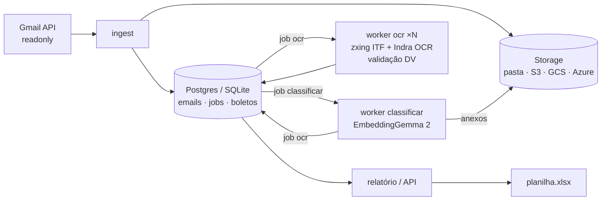

# Boletos do Gmail → planilha validada

Lê seus e-mails do **Gmail**, usa o **EmbeddingGemma 2** para separar os que trazem boleto,
lê os anexos com **leitor de código de barras + Indra OCR**, **valida os dígitos verificadores**
(padrão FEBRABAN) e gera uma planilha `.xlsx`.

O mesmo código roda:
- **local**, em um processo só (SQLite + pasta), sem Docker;
- **local ou em uma VM** com `docker compose` (Postgres + workers);
- em **qualquer Kubernetes** (EKS, GKE, AKS, OKE, k3s...), com autoscaling por fila via KEDA.

## Arquitetura



### Por que é portátil
A única parte acoplada à infraestrutura são **duas URLs**:

| Variável | Local | Docker / VM | AWS | GCP | Azure |
|---|---|---|---|---|---|
| `DATABASE_URL` | `sqlite:///dados/boletos.db` | Postgres do compose | RDS / Aurora | Cloud SQL | Azure Database for PostgreSQL |
| `STORAGE_URL` | `file://./dados/arquivos` | volume ou MinIO (`s3://` + `S3_ENDPOINT_URL`) | `s3://bucket` | `gs://bucket` | `az://container` |
| Execução | `boletos tudo` | `docker compose up` | EKS ou ECS | GKE ou Cloud Run | AKS ou Container Apps |

- **Fila no próprio Postgres** (`FOR UPDATE SKIP LOCKED`). Não há SQS, Pub/Sub nem RabbitMQ para operar,
  e a mesma tabela serve de DLQ (jobs com status `morto`, após 3 tentativas com backoff exponencial).
  Jobs presos em `rodando` porque um worker morreu voltam para a fila sozinhos depois de 15 min. Esse caminho foi testado com
  8 workers concorrentes: 200 jobs, nenhum pego duas vezes.
- **Storage via fsspec**: `file://`, `s3://`, `gs://` e `az://` com o mesmo código.
- **Idempotência em todos os estágios**: o id do Gmail é a chave do e-mail e o código de barras é a chave do boleto.
  Rodar duas vezes não duplica nada. O mesmo boleto em dois e-mails vira uma linha com `ocorrencias = 2`.

### Escala
- Os workers não guardam estado, então dá para subir quantas réplicas quiser (`docker compose up --scale ocr=8`).
- No Kubernetes, o **KEDA** lê `SELECT count(*) FROM jobs ...` e escala de **0 a N**:
  1 réplica de OCR para cada 10 anexos na fila e 1 de classificação para cada 64 e-mails.
- O OCR é só CPU (ONNX), então nenhum estágio precisa de GPU. Use nós spot/preemptíveis e ARM para os workers:
  o SIGTERM é tratado e o job não concluído volta para a fila.

## Gmail: configuração (uma vez)

**Conta pessoal @gmail.com:**
1. No [Google Cloud Console](https://console.cloud.google.com/): crie um projeto, ative a **Gmail API**,
   configure a tela de consentimento (adicione seu e-mail como usuário de teste) e
   crie uma credencial **OAuth client ID → Desktop app**. Baixe o arquivo como `secrets/credentials.json`.
2. Rode `boletos gmail-auth`. O navegador abre, você autoriza e o `secrets/token.json` é gerado.
   Esse token tem refresh, então dá para levar para o servidor ou montar como Secret no k8s.

**Google Workspace:** use service account com delegação de domínio
(`GMAIL_DELEGATED_USER=financeiro@empresa.com`). Nesse caso não precisa de navegador.

O escopo é **somente leitura** (`gmail.readonly`): o sistema nunca altera nem apaga nada no Gmail.
O filtro padrão é `GMAIL_QUERY="newer_than:30d -in:chats"`. Dá para restringir com
qualquer busca do Gmail, por exemplo `has:attachment newer_than:7d` ou `label:contas`.

## Rodar

### 1. Local, sem Docker
```bash
pip install -e ".[gmail,gemma,ocr]"
boletos gmail-auth
boletos tudo --saida boletos.xlsx          # Gmail → planilha
boletos tudo --pasta ./emails_exportados/  # ou a partir de arquivos .eml
CLASSIFICADOR=palavras boletos tudo        # sem baixar o modelo de embedding
```

### 2. Docker Compose (sua máquina ou uma VM em qualquer cloud)
```bash
boletos gmail-auth                  # gera secrets/token.json
docker compose up -d --build
docker compose up -d --scale ocr=4
curl -o boletos.xlsx localhost:8080/planilha.xlsx
curl -X POST localhost:8080/sync    # força buscar e-mails agora
curl localhost:8080/status          # tamanho da fila
```

### 3. Kubernetes (qualquer cloud)
```bash
docker build --target app -t REGISTRY/boletos-app .
docker build --target classificador -t REGISTRY/boletos-classificador .
docker build --target ocr -t REGISTRY/boletos-ocr .
# push das imagens, criar os secrets (comandos no topo do yaml) e:
kubectl apply -f deploy/k8s/boletos.yaml
```
Inclui: ingest, os dois workers com KEDA (escala até zero), API e um CronJob que gera o relatório às 7h (horário de Brasília).

## Como cada parte decide

**É boleto?** (`classifier.py`) — o classificador funciona como portão barato; quem decide no fim é o validador de DV.
1. Se o corpo do e-mail tem uma linha digitável com DV válido, é boleto (regra, sem modelo).
2. Se houver uma cabeça LogisticRegression treinada sobre os embeddings
   (`scripts/train_classifier.py`, com cerca de 150 exemplos por classe), ela decide.
3. Sem cabeça treinada, vale o zero-shot: cosseno contra protótipos de "boleto" e de "outro".
No meio-termo, se o e-mail tem anexo, ele vai para o OCR mesmo assim (recall maior que precisão).
O modelo carrega só o encoder de texto (270M), usa vetores de 256 dimensões (Matryoshka) e roda em **fp32 em CPU**.
**Nunca use fp16**: nele o EmbeddingGemma 2 devolve NaN sem levantar erro.

**Leitura do anexo** (`ocr.py`), por página:
1. Camada de texto do PDF, quando existe (o Indra em modo `auto` usa sem custo de OCR).
2. Código de barras **ITF-25** lido direto da imagem a 300 dpi (zxing-cpp). É o caminho mais confiável.
3. Texto do Indra OCR, que passa pelo extrator de linha digitável (tolera `O→0`, `l→1` e quebras).

**Validação** (`barcode.py`, puro Python, com testes)
- Bancário (44/47 dígitos): DV mod10 dos três campos e DV geral mod11.
- Arrecadação/convênio (44/48, começa com 8): mod10 ou mod11 conforme o 3º dígito.
- Extrai banco, valor e vencimento. O fator de vencimento reiniciou em 1000 no dia 22/02/2025, e o código
  escolhe o ciclo mais próximo da data do e-mail.

**Planilha:** três abas: **Boletos válidos**, **Revisar** (com o erro exato, ex.: "DV do campo 2 inválido") e
**Resumo** por mês. Vencidos ficam em vermelho e os que vencem em até 3 dias em amarelo.

## ⚠️ Antes de usar em produção
- **Licença do Indra OCR**: o código é Apache 2.0, mas os pesos usam OpenRAIL-M modificada. É gratuita para pesquisa,
  uso pessoal e empresas com menos de US$ 20M de faturamento ou captação, e não pode concorrer com a API da Datalab.
  Uma empresa grande precisa de licença comercial. Se for o caso, troque `LeitorBoleto.indra` (Tesseract, PaddleOCR,
  Textract, Document AI...); o código de barras e a validação continuam iguais.
- **DV válido não garante que o boleto é legítimo**: um boleto fraudado também tem DV correto. Para antifraude,
  compare banco e beneficiário com os fornecedores conhecidos.
- **Gmail**: com app OAuth em modo "Teste", o refresh token expira em 7 dias. Mude o app para "Em produção"
  (sem verificação, o Google só mostra um aviso de "app não verificado" no login, o que basta para uso pessoal)
  ou use Workspace com service account.
- **LGPD**: e-mails e boletos têm dados pessoais. Ative criptografia no bucket e no banco e defina
  uma política de retenção para `raw/` e `anexos/`.

## Estrutura
```
src/boletos/
  barcode.py extractor.py     validação FEBRABAN + busca de linha digitável em texto
  email_parser.py             .eml → texto + anexos
  classifier.py               EmbeddingGemma 2
  ocr.py                      zxing + Indra OCR
  gmail.py                    Gmail API (readonly, OAuth ou service account)
  db.py                       estado + fila (Postgres/SQLite)
  blob.py                     storage portátil (fsspec)
  services.py cli.py api.py   estágios, linha de comando, HTTP
  pipeline.py report.py       linhas da planilha, xlsx
Dockerfile                    alvos: app | classificador | ocr
docker-compose.yml
deploy/k8s/boletos.yaml       Deployments + KEDA + CronJob
scripts/train_classifier.py
tests/                        validação, ponta a ponta com PDF e código de barras reais, fila
```

Testes: `pip install -e ".[dev,ocr]" && pytest -q`
