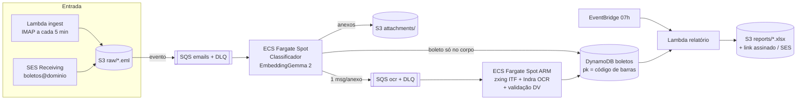

# Pipeline de boletos por e-mail — EmbeddingGemma 2 + Indra OCR na AWS

Lê e-mails, separa os que contêm boleto, extrai o código de barras dos anexos
(PDF/imagem), **valida os dígitos verificadores** (padrão FEBRABAN) e gera uma
planilha `.xlsx` com todos os boletos.

## Arquitetura



| Etapa | Serviço | Por quê |
|---|---|---|
| Ingestão | Lambda + EventBridge (IMAP) **ou** SES Receiving | Lambda serve para caixas existentes (Gmail/Outlook). SES elimina o polling se você puder criar um endereço dedicado. Os dois gravam em `raw/`, e daí em diante o fluxo é o mesmo. |
| Desacoplamento | S3 → SQS (com DLQ, KMS) | Picos de e-mail viram backlog e não erro. Reprocessar é só reenviar a mensagem. |
| Classificação | ECS Fargate (CPU), EmbeddingGemma 2 só texto (270M), MRL 256d | Modelo pequeno, roda bem em CPU e fica carregado entre mensagens (em Lambda o cold start sairia caro). |
| OCR | ECS Fargate **ARM/Graviton**, Indra OCR (ONNX, CPU) + zxing-cpp | O Indra não precisa de GPU. ARM + Spot é a combinação mais barata para carga CPU-bound. |
| Estado | DynamoDB on-demand | Idempotência por código de barras: o mesmo boleto vindo em 2 e-mails vira 1 linha (`ocorrencias = 2`). |
| Saída | Lambda → openpyxl → S3 + URL assinada (+ SES opcional) | Abas: **Boletos válidos**, **Revisar** e **Resumo** por mês. Vencidos aparecem em vermelho e os que vencem em até 3 dias em amarelo. |

### Escalabilidade
- Os dois serviços ECS usam `QueueProcessingFargateService`, com autoscaling por
  profundidade da fila e **scale-to-zero**: sem e-mail, o custo dos workers é zero.
- OCR escala até 40 tasks × 4 vCPU. Como o paralelismo é por anexo (uma mensagem por anexo), um e-mail
  com 10 PDFs é processado em paralelo.
- Fargate Spot com peso 4:1. O worker trata o SIGTERM terminando o lote em andamento, e uma
  mensagem que não recebe ack volta para a fila (*at-least-once* + idempotência no DynamoDB).
- 3 falhas mandam a mensagem para a DLQ, com alarme no CloudWatch. Também há alarme para mensagens paradas há mais de 30 min.
- Volume muito alto (milhões de linhas): troque o `Scan` do relatório por
  DynamoDB Export to S3 + Athena.

## Como cada parte decide

### 1. "É boleto?" — `src/boletos/classifier.py`
O classificador funciona como um **portão barato**. A palavra final é do validador de DV, por isso ele é calibrado
para recall alto. Os sinais, em ordem:
1. **Regra**: se o corpo do e-mail já traz uma linha digitável com DV válido, o e-mail é boleto com certeza.
2. **Cabeça supervisionada** (LogisticRegression sobre os embeddings), quando treinada com
   `scripts/train_classifier.py`. Com cerca de 150 e-mails rotulados por classe ela já supera o zero-shot.
3. **Zero-shot**: similaridade de cosseno com protótipos de "boleto" e de "outro" (`prompt_name="Classification"`).

No meio-termo (score entre 0,40 e 0,55), se o e-mail tem anexo, ele vai para o OCR mesmo assim.

Pontos de atenção do EmbeddingGemma 2:
- **nunca use float16**: em fp16 ele devolve NaN ou embeddings degradados sem levantar erro. O código usa
  fp32 em CPU e bf16 em GPU.
- Os encoders de visão e áudio ficam desligados (`config_kwargs`), o que deixa o modelo com 270M em vez de 740M.
- Se quiser usar a imagem do anexo na classificação, carregue com `{"audio_config": None}`
  (440M) e passe `{"text": "... <|image|>", "image": [png]}`.

### 2. Leitura do anexo — `src/boletos/ocr.py`
A leitura para no primeiro resultado válido de cada página:
1. **Camada de texto do PDF**: o Indra, em `mode="auto"`, usa o texto embutido quando ele existe, sem custo de OCR.
2. **Código de barras ITF-25** lido direto da imagem renderizada a 300 dpi (zxing-cpp). É a
   fonte mais confiável, porque lê as barras e não depende de OCR.
3. **Indra OCR**: o texto passa pelo extrator de linha digitável, que tolera `O→0`, `l→1` e quebras de linha.

### 3. Validação — `src/boletos/barcode.py` (puro Python, 100% testado)
- **Bancário** (44/47 dígitos): DV mod10 dos campos 1 a 3 e DV geral mod11.
- **Arrecadação/convênio** (44/48, começa com 8): mod10 ou mod11 conforme o 3º dígito.
- Converte entre linha digitável e código de barras e extrai banco, valor e vencimento.
- **Fator de vencimento com o novo ciclo**: o fator chegou a 9999 em 21/02/2025 e
  voltou a 1000 em 22/02/2025. O código escolhe o ciclo mais próximo da data do e-mail.

Nada vira boleto válido sem fechar todos os DVs. Candidatos que falham vão para a aba **Revisar**
com o erro exato (ex.: "DV do campo 2 inválido").

## Rodar local (sem AWS)

```bash
pip install -r services/classifier_worker/requirements.txt -r services/ocr_worker/requirements.txt openpyxl
python scripts/run_local.py --emails ./meus_emails/ --saida boletos.xlsx
# ou direto da caixa (somente leitura):
IMAP_PASSWORD=... python scripts/run_local.py --imap-host imap.gmail.com --imap-user voce@gmail.com
# sem baixar o modelo de embedding:
python scripts/run_local.py --emails ./meus_emails/ --classificador palavras
```

Testes (validação + ponta a ponta com PDF gerado e código de barras real):
```bash
pip install pytest reportlab zxing-cpp pypdfium2 opencv-python-headless numpy openpyxl
PYTHONPATH=src:tests pytest -q
```

## Deploy na AWS

```bash
pip install -r requirements-dev.txt && npm i -g aws-cdk
cd infra && cdk bootstrap && cdk deploy
# credenciais IMAP:
aws secretsmanager put-secret-value --secret-id <ImapCreds> \
  --secret-string '{"host":"imap.gmail.com","user":"x@gmail.com","password":"<app password>","folder":"INBOX"}'
```
Região padrão: `sa-east-1` (em `infra/app.py`). As imagens Docker baixam os modelos no
build, então em produção o container não acessa o Hugging Face.

## ⚠️ Antes de colocar em produção

- **Licença do Indra OCR**: o código é Apache 2.0, mas os **pesos** usam OpenRAIL-M modificada. Ela é gratuita
  para pesquisa, uso pessoal e empresas com menos de US$ 20M de faturamento ou captação, e
  não permite uso que concorra com a API da Datalab. Uma empresa grande (um banco, por exemplo) precisa de licença
  comercial da Datalab. Se for o caso, troque `LeitorBoleto.indra` por Textract ou outro OCR; o
  restante do pipeline não muda.
- **EmbeddingGemma 2**: Apache 2.0.
- **DV válido não garante que o boleto é legítimo.** Um boleto fraudado tem DV correto. Se o
  objetivo incluir antifraude, compare banco e beneficiário com uma lista de fornecedores conhecidos
  e sinalize quando o remetente divergir do domínio esperado.
- LGPD: e-mails e boletos têm dados pessoais. Por isso o bucket e as filas usam KMS, os e-mails brutos expiram em 90 dias e as planilhas em 30.
- O Indra é recente (v1.1.x) e mantido praticamente por uma pessoa. Fixe a versão e valide a leitura com amostras reais
  dos seus boletos. O caminho pelo código de barras reduz bastante essa dependência.

## Estrutura

```
src/boletos/        barcode.py (DV FEBRABAN) · extractor.py · email_parser.py
                    classifier.py (EmbeddingGemma 2) · ocr.py (Indra + zxing)
                    pipeline.py · report.py (xlsx) · storage.py (AWS) · worker.py (loop SQS)
services/           ingest/ (Lambda IMAP) · classifier_worker/ · ocr_worker/ · report/ (Lambda)
infra/              CDK v2 em Python
scripts/            run_local.py · train_classifier.py
tests/              test_barcode.py · test_e2e.py
```
